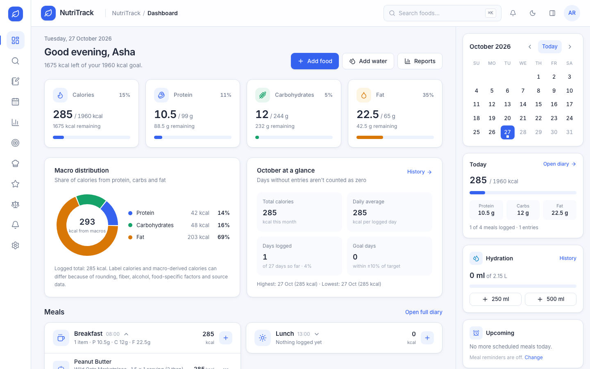
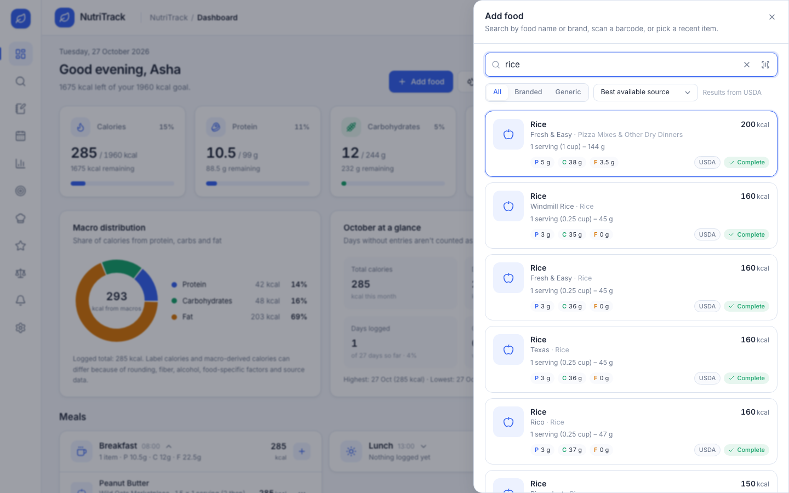
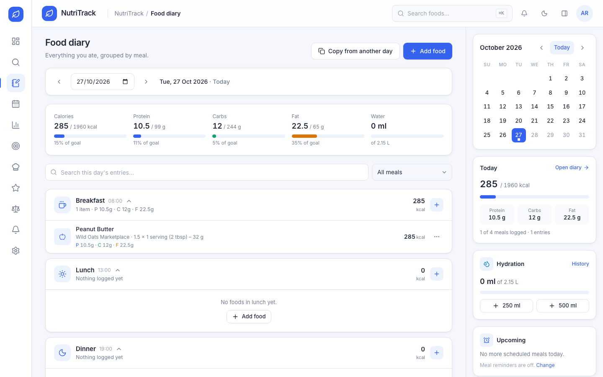
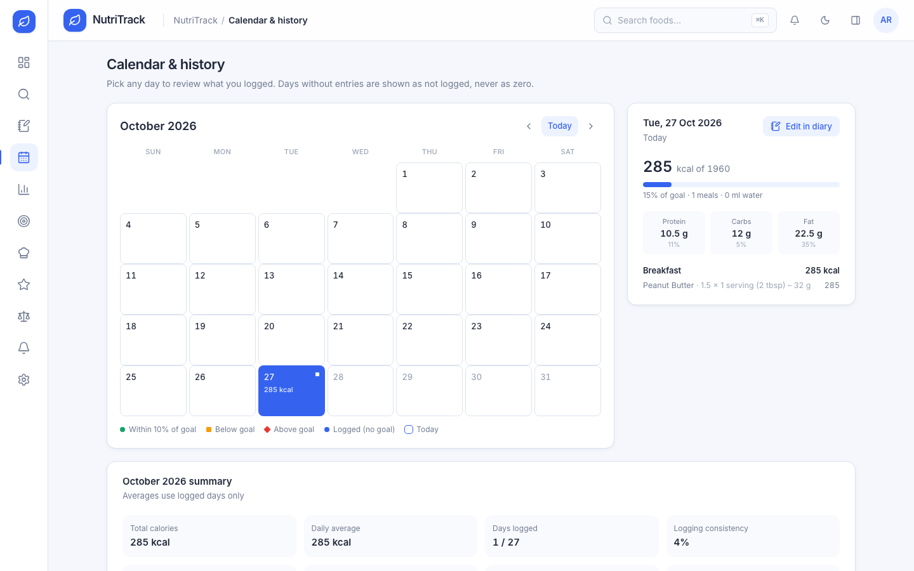
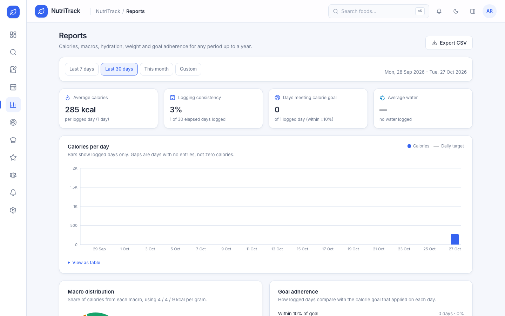
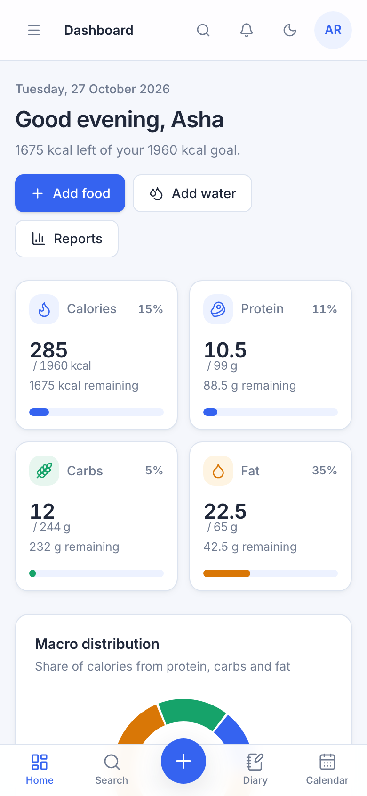
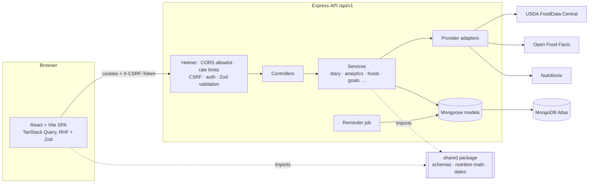

# NutriTrack

A full-stack food, macro and diet logging app. Search real foods from public nutrition
databases, pick a serving size, log meals, and review your daily, monthly and historical
nutrition against your own targets.

Built with React, Express, MongoDB and TypeScript as a college project, following production
practices: shared validated contracts, cookie-based auth with rotating refresh tokens and
CSRF protection, server-side nutrition math, and automated unit, integration and end-to-end tests.

Demo Video Link: https://drive.google.com/file/d/1ZsQT_c-xd1XlwGjzpvGq_5Ny0bkg-WhT/view?usp=sharing




| Food search (live USDA data) | Diary | Calendar & history |
| --- | --- | --- |
|  |  |  |

| Reports | Mobile |
| --- | --- |
|  |  |

## Features

**Core**
- Registration, login, logout, session restore, email verification, forgot/reset password,
  password change, device/session management, brute-force lockout.
- Onboarding wizard (profile → targets with a clearly labelled Mifflin–St Jeor *estimate* →
  preferences). Estimates never go below 1500 kcal or more than 500 kcal under maintenance.
- Food search across **USDA FoodData Central**, **Open Food Facts** and **Nutritionix**
  (whichever are configured), with branded/generic filters, pagination, debounce, cancellation,
  provider fallback, search history, recent foods and favorites.
- Serving-based calculations (per-100 g, per-100 ml and per-serving bases, food-specific portion
  weights only when the source provides them), live preview, idempotent saves.
- Dashboard: calorie/protein/carb/fat cards (overages shown, not clamped), macro-energy donut,
  meal cards with edit/duplicate/move/delete, month at a glance, recent activity, and a right-hand
  panel with calendar, selected-day summary, hydration, reminders and streak.
- Food diary: date navigation, meal sections, search/filter, edit serving, duplicate, move meal,
  change date, delete with undo, copy from another day with review, meal subtotals and daily totals.
- Monthly calendar with logged/met/under/over indicators, keyboard navigation and per-day detail.
  Days without logs are never treated as 0 kcal.

**Additional**
Favorites · custom foods · saved meals · recipe builder with portions · barcode scanning (camera
+ manual) · water tracking · weight tracking with trends · weekly/monthly/custom reports with CSV
export · streaks and milestones · in-app meal/hydration/goal notifications (email when SMTP is
configured) · allergen and excluded-food warnings (only when the source provides data) · personal
data export and account deletion · keyboard shortcuts (`⌘/Ctrl K`, `/`, `a`, `g` + letter, `?`)
· dark mode · loading skeletons, empty and error states throughout.

## Architecture



- **shared/** – Zod request schemas, response types, nutrition math, date-only helpers. The server
  computes and stores nutrition with `calculateConsumed`; the client uses the same function only to
  preview, so preview and saved values cannot disagree.
- **server/** – controllers (HTTP), services (business rules), models (persistence), provider
  adapters (external APIs), middleware, jobs. Mongoose models act as the repository layer.
- **client/** – feature folders (`features/*`), data hooks per domain (`services/*`), UI primitives
  (`components/ui`), feedback components (skeletons/empty/error), layout shell.

More detail: [docs/API.md](docs/API.md) (every endpoint, errors, invalidation) and
[docs/DATABASE.md](docs/DATABASE.md) (schemas, indexes, retention, consistency rules).

## Tech stack

| Layer | Choices |
| --- | --- |
| Client | React 19, Vite 8, TypeScript (strict), React Router 7, TanStack Query 5, React Hook Form + Zod 4, Tailwind CSS 4 (design tokens), Radix primitives, Lucide, Recharts 3, date-fns, Zustand, ZXing (barcodes) |
| Server | Node.js (≥ 20.19), Express 5, Mongoose 9, Zod 4, Argon2id, jose (JWT), Helmet, CORS, express-rate-limit, Pino, Nodemailer |
| Data | MongoDB Atlas (replica set; transactions for copy-day and account deletion) |
| Tests | Vitest, Supertest, mongodb-memory-server, React Testing Library, Playwright |

## Repository layout

```
nutritrack/
├─ shared/src/            schemas.ts · api.ts · nutrition.ts · dates.ts · energy.ts · allergens.ts
├─ server/
│  ├─ src/config/         env validation, logger, db
│  ├─ src/middleware/     auth, csrf, validate, rate limits, errors, request ids
│  ├─ src/models/         Mongoose schemas
│  ├─ src/services/       auth, tokens, foods, diary, analytics, goals, templates, tracking, …
│  ├─ src/providers/nutrition/  usda.ts · openFoodFacts.ts · nutritionix.ts · fixture.ts · registry.ts
│  ├─ src/controllers/ · src/routes/ · src/jobs/ · src/tests/
│  └─ scripts/            dev-db.mjs (local MongoDB) · e2e-db.mjs
├─ client/
│  ├─ src/app/            App, router
│  ├─ src/features/       auth, onboarding, dashboard, food-search, food-log, calendar, reports,
│  │                      goals, recipes, favorites, tracking, settings, notifications, landing
│  ├─ src/components/     ui, layout, feedback, charts
│  ├─ src/services/       typed API hooks per domain
│  ├─ src/tests/          unit/component tests
│  └─ e2e/                Playwright specs
├─ docs/                  API.md · DATABASE.md · screenshots/
└─ .github/workflows/ci.yml
```

## Getting started

### Prerequisites
- Node.js **20.19+** (tested on 26) and npm 10+
- A MongoDB database: **MongoDB Atlas** (recommended) or the bundled local dev database
- At least one nutrition provider (USDA's free key is the easiest)

### Install

```bash
npm install
```

### Configure

```bash
cp server/.env.example server/.env
cp client/.env.example client/.env
```

Fill in `server/.env`. Generate the two secrets with:

```bash
node -e "console.log(require('crypto').randomBytes(48).toString('base64url'))"
```

The server validates its configuration at startup and lists any missing or invalid variable
**names** (never values).

### Database

**MongoDB Atlas (production and recommended for development)**
1. Create a free cluster at [cloud.mongodb.com](https://cloud.mongodb.com).
2. *Database Access*: add a user with read/write on the `nutritrack` database.
3. *Network Access*: allow your IP (and your API host's egress IPs in production).
4. *Connect → Drivers*: copy the `mongodb+srv://` URI, set the database name to `nutritrack`,
   and put it in `MONGODB_URI`.
   Atlas clusters are replica sets, so multi-document transactions work.

**Local development database (no Atlas account needed)**

```bash
npm run db:dev -w server
```

This starts a single-node replica set on port 27018 (data persisted in `server/.dev-db/`) and
prints the URI. The default in `.env.example` already points to it.

### Nutrition API credentials

| Provider | Access | Configure | Notes |
| --- | --- | --- | --- |
| USDA FoodData Central | Free API key: [fdc.nal.usda.gov/api-key-signup](https://fdc.nal.usda.gov/api-key-signup) | `USDA_API_KEY` | Generic + branded US foods, food-specific portions. Default limit 1,000 requests/hour per key. `DEMO_KEY` works for a quick trial but is heavily rate-limited. Public domain data. |
| Open Food Facts | No key | `OPEN_FOOD_FACTS_ENABLED=true`, set `OPEN_FOOD_FACTS_USER_AGENT` to identify your app and contact | Packaged products worldwide, barcodes, allergen tags. ODbL licence: attribution is shown on every item. Search is limited to ~10 requests/min, so it is never called per keystroke (debounced, cached, throttled server-side). |
| Nutritionix | Requires an approved developer account: [nutritionix.com/business/api](https://www.nutritionix.com/business/api) | `NUTRITIONIX_APP_ID`, `NUTRITIONIX_API_KEY` | Branded and common foods. Availability, quotas and pricing are set by Nutritionix; check their current terms. |

When several are configured, automatic search uses Nutritionix → USDA → Open Food Facts and falls
back to the next one if a provider fails (the UI says which source answered and why). If every
provider fails, the API returns `503` and the UI offers retry or a custom food. Nothing is invented.

### Email

Set `EMAIL_PROVIDER=smtp` and the `SMTP_*`/`EMAIL_FROM` values for any SMTP service (Resend,
SendGrid, Mailgun, Amazon SES, Gmail app password, …). With `console` (development only) messages
and links are written to the API log; with `none` nothing is sent. In both cases the UI says email
delivery isn't configured instead of claiming it was sent.

### Run

```bash
npm run db:dev -w server   # only if you're using the local database
npm run dev                # API on :4000, web on :5173 (Vite proxies /api)
```

Open http://localhost:5173.

## Scripts

| Command | What it does |
| --- | --- |
| `npm run dev` | API (tsx watch) + web (Vite) |
| `npm run lint` | ESLint (TypeScript, React hooks/compiler rules) |
| `npm run typecheck` | `tsc --noEmit` for shared, server, client |
| `npm test` | Shared unit tests, server integration tests (in-memory MongoDB replica set), client component tests |
| `npm run test:e2e` | Playwright: starts an isolated in-memory MongoDB, the API with the synthetic fixture provider, and Vite |
| `npm run build` | Server bundle (`server/dist`) and client bundle (`client/dist`) |
| `npm run check` | lint + typecheck + test + build |
| `npm run start -w server` | Run the built API |

Tests never touch Atlas: integration tests use `mongodb-memory-server`, and E2E uses its own
throwaway instance on port 27019.

## Deployment

The recommended setup serves the web app and the API from the **same site** so auth cookies are
first-party (`SameSite=Lax`):

1. **API** on any Node host (Render, Railway, Fly.io, a VM). A [Render blueprint](render.yaml) is
   included. Build: `npm ci && npm run build -w server`; start: `npm run start -w server`;
   health check: `/health/ready` (liveness: `/health/live`). Set `NODE_ENV=production`,
   `TRUST_PROXY=1` behind a proxy, `CLIENT_ORIGIN` and `APP_URL` to your web URL, and the secrets.
2. **Web** on Vercel or Netlify. Build `npm run build -w client`, output `client/dist`. Edit
   [`client/vercel.json`](client/vercel.json) so `/api/*` rewrites to your API host; keep
   `VITE_API_BASE_URL=/api/v1`. (Netlify: an equivalent `_redirects` rule
   `/api/*  https://your-api/api/:splat  200` plus `/* /index.html 200`.)
3. **Atlas**: allow the API host's egress IPs.

If the web app and API must live on different sites, set `COOKIE_SAMESITE=none` (requires HTTPS;
cookies become `Secure`), set `VITE_API_BASE_URL=https://your-api/api/v1`, and add the web origin
to `CLIENT_ORIGIN`. CSRF still works because the token is delivered in response bodies. Some
browsers block third-party cookies, so the same-site setup is more reliable.

### Production security checklist
- [ ] `NODE_ENV=production`; unique random `JWT_ACCESS_SECRET` and `CSRF_SECRET` (≥ 32 chars)
- [ ] `CLIENT_ORIGIN` lists only your web origin(s); HTTPS everywhere
- [ ] `TRUST_PROXY` matches your proxy hops (rate limits rely on the client IP)
- [ ] Atlas user with least privilege; network access restricted
- [ ] `ENABLE_FIXTURE_PROVIDER` unset (refused in production anyway)
- [ ] `EMAIL_PROVIDER=smtp` with a verified sending domain, or `none`
- [ ] `npm audit --omit=dev` clean; CI green
- [ ] No `.env` files committed (see `.gitignore`)

## Security notes

- Passwords: Argon2id (19 MiB, t=2). Hashes are never selected or returned.
- Sessions: 15-minute JWT access cookie + opaque refresh cookie (path-scoped to `/api/v1/auth`),
  stored only as SHA-256 hashes, rotated on every refresh. Replaying an old token after a 30-second
  grace window revokes the session. Logout, password change/reset and device revocation take effect
  immediately because each request checks the session.
- CSRF: signed double-submit token in a header on every mutating request.
- Generic login errors; uniform forgot-password responses; per-IP+email login limits and account
  lockout after 5 failures.
- Every query is scoped by the authenticated user id; other users' ids return `404`.
- All inputs are parsed by Zod into primitive types (no operator injection); Express uses the
  simple query parser; JSON bodies are limited to 100 KB.
- External API responses are schema-validated; images are only passed through from allow-listed
  HTTPS hosts; redirects are refused on outbound requests.
- CSV export prefixes cells starting with `= + - @` and escapes quotes/newlines.
- Logs omit headers, cookies and bodies and redact secret-like fields.

## Nutrition data rules

- Per-100 g: `grams = gramsPerServing × servings`, `nutrient = per100g × grams / 100`.
- Per serving: `nutrient = perServing × servings` (gram options convert through the labelled
  serving weight only when the source states it).
- Volume measures (cups, tbsp) appear only when the source gives a food-specific gram weight.
- Missing nutrients stay `null` and are reported as "not reported"; totals show how many entries
  lacked a value.
- Macro-derived calories use 4/4/9 kcal/g and can differ from label calories (rounding, fiber,
  alcohol, source data); the UI explains this.
- Energy estimates are labelled as estimates and are always editable.

## Troubleshooting

| Symptom | Fix |
| --- | --- |
| `Invalid server configuration` at startup | Fill the listed variables in `server/.env` |
| `MongoServerSelectionError` | Check `MONGODB_URI`, Atlas network access, or start `npm run db:dev -w server` |
| Search says no database is configured | Set `USDA_API_KEY` (or another provider) and restart the API |
| Search returns `PROVIDER_UNAVAILABLE` / rate-limited | USDA `DEMO_KEY` and Open Food Facts have low limits; use a real USDA key |
| Signed out after every refresh in production | Cookies are cross-site: use the same-site rewrite, or `COOKIE_SAMESITE=none` over HTTPS |
| "Security token invalid" | The CSRF cookie was cleared; reload the page |
| Verification emails never arrive | `EMAIL_PROVIDER` is `console`/`none`; configure SMTP |
| Camera scanning unavailable | Needs HTTPS (or localhost) and camera permission; type the barcode instead |

## Known limitations

- Nutritionix integration follows their documented v2 API, but it was not exercised against a
  live account during development (no credentials were available); USDA and Open Food Facts were
  verified against live responses, and recorded samples are used in tests.
- Nutritionix instant search isn't paginated; Open Food Facts search is rate-limited by design.
- Reminders are in-app notifications created by a once-a-minute job (plus email when SMTP is
  configured); there are no browser push notifications.
- Sessions last 30 days from sign-in (absolute), then require signing in again.
- Changing the account email address isn't supported yet.
- Allergen warnings depend on source data (mainly Open Food Facts) and can't guarantee safety.
- Not medical advice.
